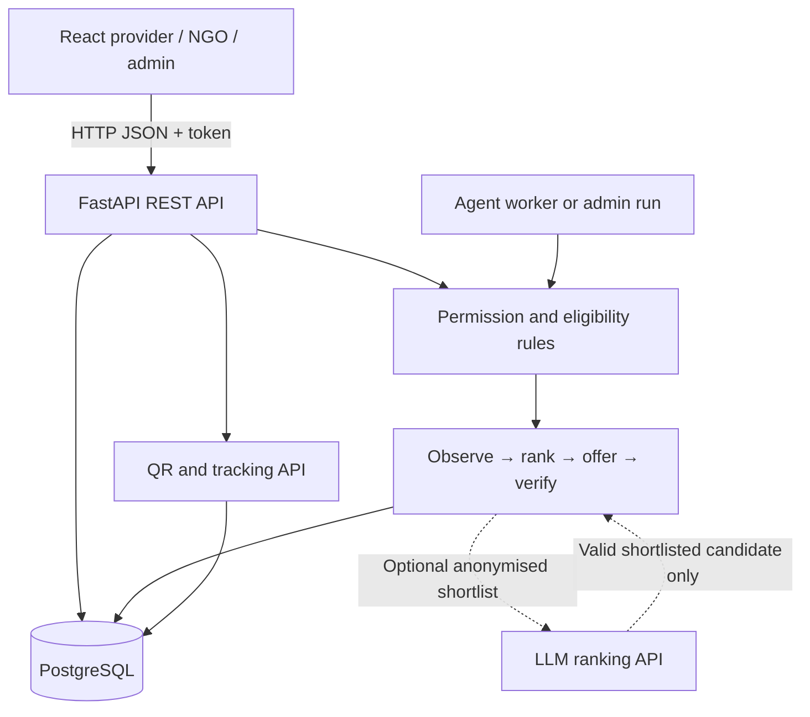
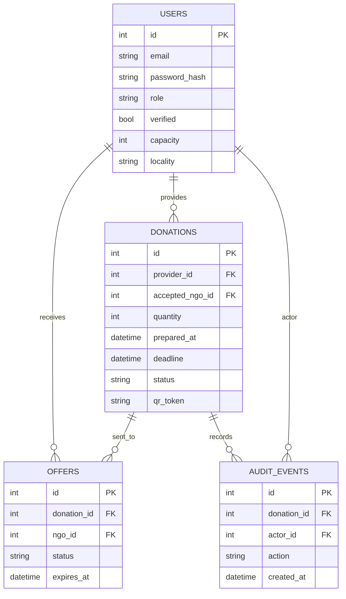

# Technical architecture — Food Rescue

## Module boundaries

1. **Authentication:** signed JWT and scrypt-salted password hash, roles `provider`, `ngo`, `admin`.
2. **Verification:** only admin can approve/revoke users.
3. **Donations:** provider-created food records, current state, deadline, cancellation and editing.
4. **Matching:** hard checks of verification, capacity, approximate geographic area, demo/live data separation and timing.
5. **Agent:** bounded observe/evaluate/act/verify loop; 15-minute offers; subsequent polling processes decline and timeout. Optional constrained LLM chooses among verified candidates only.
6. **Offers:** `pending`, `accepted`, `declined`, `timed_out`, `withdrawn`; first valid acceptance changes the donation record with a PostgreSQL row lock.
7. **QR:** accepted donation generates a unique random token; authorised NGO token confirmation moves to `picked_up`; NGO receipt moves to `completed`; audit events store timestamps. Physical handover must be separately verified by people.
8. **Reporting:** status/offer counts, completion totals and audit activity from stored application data.

## Simplified database ER diagram

## Design decisions and tradeoffs

- Structured SQL relations protect account/offer/donation integrity better than disconnected spreadsheets.
- Postgres row locking prevents concurrent accepted offers on a single donation when transactions follow the defined path.
- Demo records are kept distinct from live ones, and all seeded NGO names are fictional.
- Coordinates are locality approximations **only**, not real road-time routing; unknown areas are escalated.
- State transition and role checks are in FastAPI rather than entrusted to an LLM.
- A simple worker with one-process polling supports student demonstrations. A production job queue, locks/idempotency and migrations would be needed before deployment.
